# Delivery boundaries (five workstreams, one engineer each)

The work is split into five **boundaries**. Each has its own plan, prompt and status file in its folder. One engineer (human or AI agent) owns one boundary and follows only that folder's plan, plus this file for the shared rules.

| Folder | Boundary | One-line mission |
| --- | --- | --- |
| [`infra/`](infra/) | Infrastructure Setup | Repo/container/local-stack tooling, Terraform on AWS, **GitHub Actions** CI/CD, deployment and acceptance |
| [`db/`](db/) | Database & User Management | Schema, migrations, seed data, accounts, roles, RBAC and record scoping, workflow/audit/concurrency core |
| [`ui-ux/`](ui-ux/) | UI Development & Git Integration | Shell, design system, pages 01–18, landing page, application commands behind those pages, Git/PR flow |
| [`ext-svc/`](ext-svc/) | External Service Integrations | Six mocks, adapter pipeline, object storage, webhooks, jobs, integration pages 19–26 |
| [`test-auto/`](test-auto/) | Test Automation & Validation | Harness, browser/axe/journey/failure-matrix/security suites, report, cross-boundary defect hunting |

Each folder contains `IMPLEMENTATION-PLAN.md` (what to build, stories, order, contracts), `AI-IMPLEMENTATION-PROMPT.md` (copy into the agent) and `STATUS.md` (created by the engineer in their first story).

## Source of truth

| Order | Document | Used for |
| --- | --- | --- |
| 1 | User's latest instructions, `docs/TECHNICAL-DECISIONS.md` | Decisions |
| 2 | `docs/VA_MISI_Technical_Challenge_3 1.pdf` | Product behaviour |
| 3 | [`IMPLEMENTATION-PLAN.md`](IMPLEMENTATION-PLAN.md) (master) | Full architecture, assumptions A-01…, every story's acceptance criteria (AC) |
| 4 | This folder's boundary plan | Ownership, order, hand-offs, boundary-specific changes |
| 5 | Code, config, tests, command output | Evidence of what exists; never permission to weaken a requirement |

The master plan keeps all story acceptance criteria. A boundary plan lists the stories it owns and says what to change; it does not repeat the AC text. If a boundary plan and the master disagree, the boundary plan wins for its own stories; record the difference in that boundary's `STATUS.md`.

`z_app-only/` and `z_deploy-infra-only/` are archived (earlier two-track split, Azure DevOps wording). Do not use them. Story IDs are unchanged, so their content still maps onto the master plan.

## What changed: GitHub Actions instead of Azure DevOps

Decision by the user, 2026-10-15. AWS stays.

| Was (Azure DevOps) | Now (GitHub Actions) |
| --- | --- |
| Azure Repos | GitHub `wslabwsllc/misi-code-challenge-brief-3` (existing `origin`) |
| `pipelines/*.yml`, `pipelines/templates/` | `.github/workflows/{pr-validation,deploy,destroy}.yml`, reusable workflows (`workflow_call`) and composite actions in `.github/` |
| OIDC provider `vstoken.dev.azure.com/<org>` (challenge 2) | IAM OIDC provider `token.actions.githubusercontent.com`, audience `sts.amazonaws.com` (a provider may not exist yet in the account; see infra E14-02) |
| Roles `misi3-ado-plan` / `misi3-ado-deploy`, path `/ado/` | Roles `misi3-gha-plan` / `misi3-gha-deploy`, path `/gha/` |
| Service connections `aws-misi3-plan` / `aws-misi3-deploy` | `aws-actions/configure-aws-credentials` with `role-to-assume`; job permission `id-token: write` only on jobs that call AWS |
| Environment `aws-misi3-dev` + Exclusive Lock | GitHub Environment `aws-misi3-dev` (deployment branch rule `main`, optional required reviewer) + `concurrency` group with `cancel-in-progress: false` |
| Variable group `misi3-aws-dev` | Repository variables (non-secret): `AWS_REGION`, `AWS_ACCOUNT_ID`, `TF_STATE_BUCKET`, `BASE_DOMAIN`, `DNS_MODE`. No GitHub secrets for AWS |
| Branch policy on `main` | Repository ruleset on `main`: PR required, required status checks, no force push |
| `docs/aws/AZURE-DEVOPS-SETUP-GUIDE.md` | `docs/aws/GITHUB-ACTIONS-SETUP-GUIDE.md` |
| Pinned agent image | `runs-on: ubuntu-24.04`; every third-party action pinned to a full commit SHA; tools by checksum |

AWS account `641944125809`, region `us-east-1`, prefix `misi3`, state bucket `misi-event-permits-tf-state`, ECR repos and VPC CIDRs are unchanged. Current deployments have no domain and therefore use each ALB's HTTP DNS name. When a domain is later supplied, Terraform enables ACM DNS validation, Route 53 records when selected, HTTPS on `${environment}-brief3.<base_domain>`, and HTTP-to-HTTPS redirect. Challenge-2 resources (including its legacy Azure DevOps roles and provider) must never be touched.

## Ownership map

### Stories

| Boundary | Stories (IDs from the master plan) |
| --- | --- |
| infra | E0-01, E0-02, E0-03, E0-05 (hosting side), E0-07, E0-08, E14-00…E14-12, E15-01…E15-06, E16-01 (README), E16-02 (ARCHITECTURE.md) |
| db | E1-01, E1-02, E1-03, E2-01…E2-07, E6-02, E7-04, E9-01, E12-01, E12-02 (app side), E16-02 (ERD, WORKFLOW, ROLE-MATRIX) |
| ui-ux | E0-04, E0-09, E1-04, E1-05 (page 18), E4-01…E4-04, E5-01, E5-03, E6-01, E6-03, E6-04, E6-05, E6-06, E7-01, E7-02, E7-03, E8-01…E8-04, E9-04, E11-01, E11-02, E13-02 (headers/antiforgery), E16-03 (app OpenAPI), G-01, G-02 |
| ext-svc | E3-01…E3-06, E5-02, E6-07, E6-08, E7-05, E9-02, E9-03, E9-05, E10-01…E10-04, E12-02 (mock side), E16-02 (INTEGRATIONS.md), E16-03 (mock OpenAPI) |
| test-auto | E0-06, E12-03, E12-04, E12-05, E13-01, E13-02 (scans, log-leak test), E13-03, E13-04, E13-05, E16-04, E16-05, E16-06 (traceability, limitations), all browser/axe tests for pages 01–26 |

New stories added by this split: **G-01** Git workflow and PR conventions, **G-02** CODEOWNERS and integration (merge) duty, **E15-06** workflow hardening. All three are defined in the owning plan.

### Pages (26)

| Boundary | Pages |
| --- | --- |
| ui-ux | 01 Dashboard, 02 Register, 03 Wizard, 04 Detail, 05 Review Queue, 06 Info Inbox, 07 Calendar, 08 Venue Availability, 09 Resource Planner, 10 Approvals, 11 Permit Center, 12 Notification Center, 13 Roster, 14 Check-In, 15 Incidents, 16 Reports, 17 Admin Venues, 18 Admin Users & Rules |
| ext-svc | 19 Integration Hub, 20 Registry Verification, 21 Calendar Sync, 22 Messaging Monitor, 23 Document Vault, 24 Weather, 25 Data Import, 26 Venue Map |

### Files and folders (write access)

| Path | Owner |
| --- | --- |
| `src/EventPermits.Domain/**` | db |
| `src/EventPermits.Application/{AppDbContext,Core,Actor,Capabilities,Errors}.cs` | db |
| `src/EventPermits.Application/Services/Admin.cs` (users, roles, rules, templates, audit viewer) | db |
| `src/EventPermits.Application/Services/{Cases,CaseFacts,Register,Reviews,Approvals,Permits,Operations,Dashboard,Scheduling}.cs` | ui-ux |
| `src/EventPermits.Application/Services/{Files,Integrations,CalendarSync,Notifications}.cs`, `Ports.cs`, `FileSignatures.cs` | ext-svc |
| `src/EventPermits.Infrastructure/{Persistence.cs,Migrations/**,Seeding/**,HmacSigner.cs}` | db (`HmacSigner.cs` shared by ext-svc: change only by request) |
| `src/EventPermits.Infrastructure/{ObjectStore.cs,Integrations/**}` | ext-svc |
| `src/EventPermits.Infrastructure/{PdfRenderer.cs,SimplePdf.cs}` | ui-ux |
| `src/EventPermits.Mocks/**`, `src/EventPermits.Mocks/Dockerfile` (content), `data/reference/{registry,calendar-events,weather,geocode}.json` | ext-svc |
| `data/reference/sites.json` | db |
| `src/EventPermits.Web/Components/**` (shell, shared components, pages 01–18, landing, login UI) | ui-ux |
| `src/EventPermits.Web/Components/Pages/Integrations/**`, `…/Documents/**`, `…/Venues/Map*` (pages 19–26) | ext-svc |
| `src/EventPermits.Web/Api/{CaseEndpoints,ApiEndpoints,ProblemExceptionHandler}.cs` | ui-ux |
| `src/EventPermits.Web/Api/{AccountEndpoints,AdminEndpoints}.cs` | db |
| `src/EventPermits.Web/Api/{FileEndpoints,WebhookEndpoints}.cs` | ext-svc |
| `src/EventPermits.Web/Hosting/{HostingOptions,Correlation,Pipeline,AdminCli}.cs` | infra |
| `src/EventPermits.Web/Hosting/{Jobs,JobHost}.cs` | ext-svc |
| `src/EventPermits.Web/Hosting/ServiceSetup.cs` | shared: see "Shared files" |
| `Dockerfile`, `.dockerignore`, `compose.yml`, `tools/Dev/**`, `infra/**`, `.github/workflows/**`, `.github/actions/**`, `docs/aws/**`, `docs/CONFIGURATION.md`, `global.json`, `Directory.*.props`, `.editorconfig`, `.gitleaks.toml`, `docs/DEPENDENCIES.md` | infra |
| `compose.yml` blocks for `mock-*` services and `minio/storage` init | ext-svc (inside blocks marked `# BEGIN ext-svc` / `# END ext-svc`) |
| `.github/CODEOWNERS`, `.github/pull_request_template.md`, `docs/GIT-WORKFLOW.md`, `docs/UI-DESIGN.md` | ui-ux |
| `tools/Dev/{TestCommand,Smoke,Scan}.cs` (exception to the infra row above) | test-auto |
| `tests/**/Support/**`, `tests/EventPermits.BrowserTests/**`, `tests/**/Journeys/**`, `tests/**/Security/**`, `docs/test-report/**`, `docs/screenshots/**`, `docs/REQUIREMENTS-TRACEABILITY.md`, `docs/DEMO-RUNBOOK.md`, `docs/ACCESSIBILITY-CHECKLIST.md`, `docs/KNOWN-LIMITATIONS.md` | test-auto |
| `tests/EventPermits.UnitTests/<Boundary>/**`, `tests/EventPermits.IntegrationTests/<Boundary>/**` | that boundary's owner (`Db`, `Ui`, `ExtSvc`, `Infra`) |
| `docs/plan/<boundary>/**` | that boundary |
| `docs/ASSUMPTIONS-LOG.md`, `docs/TECHNICAL-DECISIONS.md`, `docs/IMPLEMENTATION-LOG.md`, `README.md` | shared: append-only, own rows only |

### Shared files

Rules to avoid merge conflicts:

1. Append only; never reorder or rewrite another boundary's rows.
2. Dependency-injection registrations go into a per-boundary extension method in the owner's own file (`AddDbServices`, `AddUiServices`, `AddExtSvcServices`, `AddInfraHosting`). `ServiceSetup.cs` only calls them.
3. Navigation entries and the page list live in `Components/PageCatalog.cs` (ui-ux). ext-svc adds its eight entries through a pull request reviewed by ui-ux; nothing else edits it.
4. Schema changes (`Entities.cs`, migrations) are made **only by db**. Anyone else files a request.
5. Assumption IDs: ui-ux A-32…A-39, db A-40…A-49, ext-svc A-50…A-59, infra A-60…A-69, test-auto A-70…A-79. Decision IDs: ui-ux `U-nn`, db `B-nn`, ext-svc `X-nn`, infra `I-nn`, test-auto `T-nn` (the old deploy-track `D-1…D-17` are renumbered `I-01…I-17`).

## Contracts between boundaries

| From → To | Contract | Where it lives |
| --- | --- | --- |
| db → all | Transition table `Workflow.cs` (T1–T14), `Actor`, `Capabilities` policies, scope filters, audit + concurrency helpers, `AppDbContext`, RuleSettings, seeded accounts (README table), role matrix | `Domain/`, `Application/`, `docs/ROLE-MATRIX.md`, `docs/WORKFLOW.md`, `docs/ERD.md` |
| db → ext-svc, ui-ux | New or changed entities/columns, delivered as a migration plus a note in db `STATUS.md` ("Schema changelog") | `Migrations/`, db STATUS |
| ext-svc → ui-ux, db | Ports in `Ports.cs` (`IApplicantRegistry`, `ICalendarClient`, `INotificationGateway`, `IWeatherClient`, `IGeocoder`, `IPartnerFeedSource`, `IObjectStore`), signed-link service, integration read models (registry evidence, weather/ack status, calendar reconciliation status) | `Ports.cs`, ext-svc STATUS "Provided contracts" |
| ui-ux → test-auto | Route list (`PageCatalog.cs`), stable accessible names / `data-testid` attributes, a one-paragraph **test hook sheet** per page in ui-ux STATUS (states, selectors, seeded data used) | `PageCatalog.cs`, ui-ux STATUS |
| infra → all | Run commands (`tools/Dev ...`), Compose stack, `docs/CONFIGURATION.md`, CI workflows and required checks, image names and tags | `tools/Dev`, `.github/workflows` |
| all → infra | Every new setting is added to `docs/CONFIGURATION.md` (key, default, secret?, local source) in the same PR | `docs/CONFIGURATION.md` |
| test-auto → all | Defect reports with a failing test name, steps and correlation ID | target boundary's STATUS, section "Requests" |

**Requests protocol.** A need that crosses a boundary is never solved by editing the other boundary's files. Write an entry in the *target* boundary's `STATUS.md` under "Requests from other boundaries" (what, why, smallest change, how to test, requester, date) and continue with independent stories. The owner answers within the same STATUS table (`accepted`, `done <sha>`, `declined <reason>`). The requester may make the change only if the owner agrees in writing in that entry.

## Milestones and the order the boundaries work in

Milestones M0–M4 keep their master-plan meaning. Infra's old D0–D4 map onto them: D0/D1 run in parallel with M0, D2 = M0 deploy, D3 = M2 deploy, D4 = M4.

```mermaid
flowchart LR
  subgraph M0["M0 walking skeleton"]
    infraA["infra: repo, Compose, tools/Dev, CI, Terraform skeleton"]
    dbA["db: schema baseline, Identity, seeded accounts"]
    uiA["ui-ux: shell, landing, login UI"]
    extA["ext-svc: registry mock, object store"]
    testA["test-auto: three-suite harness"]
  end
  M0 --> M1["M1 thin journey: db core + ui-ux commands/pages + ext-svc pipeline/storage/worker; test-auto happy-path journey"]
  M1 --> M2["M2 all 26 pages + all integrations normal mode; test-auto page and axe suites"]
  M2 --> M3["M3 failure matrix, security hardening, mock scenarios"]
  M3 --> M4["M4 release: full seed, docs, screenshots, report, clean clone, AWS acceptance, destroy drill"]
```

Daily rhythm: each engineer merges small story PRs; the **integration owner** (ui-ux, story G-02) merges in dependency order (db → ext-svc → ui-ux → test-auto → infra when they touch the same area), test-auto runs the full stack after every merge to `main`, and any failure becomes a request to the owning boundary.

## Rules every boundary follows

All rules in `CLAUDE.md` apply. In addition:

- **One boundary per session.** Name it at the top of the session. After a context reset keep the same boundary; check which `STATUS.md` your latest commits touched.
- **Branches and commits.** Branch `<boundary>/<story-id>-<slug>`; commit message `<story-id>: 
`; only that story's files; open a PR to `main` (ask first, see action boundaries). Details in `docs/GIT-WORKFLOW.md` (ui-ux G-01).
- **Definition of Done** is master plan section 6.2, plus: your `STATUS.md` updated, `docs/CONFIGURATION.md` updated for new settings, no edits outside your owned paths, requests answered or logged.
- **Evidence.** *Passed* only with successful command output; otherwise *failed*, *not executed* (reason + exact command) or *blocked*. Configured CI is not executed CI.
- **Never commit** secrets, `.data/`, `.terraform/`, state or plan files. The fixed local demo password `EventPermits!Demo2026` is the single documented exception (OD-2).
- **Action boundaries.** Ask at that moment before: commands using AWS credentials, `git push`, creating PRs, running or dispatching GitHub workflows, changing repository settings, and anything destructive.
- **Starting state.** The repository already contains code (domain, services, API, mocks, worker, Compose stack, `tools/Dev`, integration tests; see `docs/IMPLEMENTATION-LOG.md`). Your first step is to reconcile your `STATUS.md` with the code and the archived `z_app-only/STATUS.md`: mark what is truly done with evidence, and do not rebuild it.
